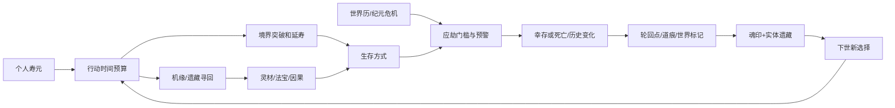

# 04 · 修行、机缘、应劫与跨世因果的系统耦合 V0.3

> 入口依旧只有四个：**修行 / 机缘 / 应劫 / 轮回**。复杂度来自选择之间有意义的联系，而非不断新增“需要点红点”的分支页面。

## 一、系统职责
| 主入口 | 主要动作 | 随进度解锁的子内容 |
|---|---|---|
| **修行** | 自动产修为、突破延寿、功法倾向 | 炼丹延寿、闭关、悟道 |
| **机缘** | 探索、风险抉择、寻找前世遗藏 | 法宝、器魂、遗迹和势力关系 |
| **应劫** | 查看下次纪元关口、配置生存条件、应对异象 | 护身丹、阵法、结盟、法则抗性 |
| **轮回** | 主动转世、结算 RP、管理魂印和世录 | 纪元锚点与历史记录 |

注意：命格不等于“必须刷到神级才有资格存活”，应劫也不是一个永远固定的“打雷战斗页”。

## 二、最小资源集合
- **修为**：自动增长的大数，境界突破转换为更高修炼速度、能力与个人寿限。
- **灵石**：交易、探索和少量任务的通用资源，修行/道具/应劫共用。
- **灵材**：药草、矿料、阵材首版用一种分类资源表示；后续只有确实增加决策时才拆分。
- **特殊实体与魂印**：少量有独特效果的非通用货币物件，保存唯一性/条件。
- **RP/DP/EP**：跨世三阶可消费货币，依次在普通转世、化神证道、飞升/高阶篇章进度中解锁；日常只出现RP，高层见 [13](13-PRESTIGE-LAYERS.md)。道痕和世录仅为纪录与门槛，不是货币。

**年数也具有价值**：修炼、炼丹、寻前世物件、准备斩杀线争夺同一份寿元时间。

## 三、真正的多系统因果

## 四、三种同等可理解的生存思路
**事件：浮岚历60年·灵潮逆涌（示例）**
- 修行路线：尽快突破某一稳定境界，凭自身能力存活。
- 丹道路线：用灵材炼制护脉丹，抵御最危险的灵气冲击；花费材料和多年准备。
- 依附路线：提前完成听潮观委托，换取进入护山阵庇护的资格。
不要求三条路线的所有细节在首版上线都同等复杂；但必须确保至少两条**不依赖 RNG**的可行路径，另外稀有机缘能够形成惊喜捷径。

## 五、前世遗藏怎样参与核心循环
- 上世在安全洞府留下「旧纹护心玉」→ 下世可根据线索消耗若干世界年寻回 → 这一次斩杀线的“灵潮抗性”获得加成。
- 当前寿元将尽 → 要不要先出门找旧物？若路途过久，可能直接寿尽；若去寻宝，突破的时间就更紧张。
- 某势力被玩家上一世帮助 → 本世找回其托管宝物的支线简化；若该势力因纪元战败迁徙，则提供新的调查路线。
- 收藏物/前世物件不全是直接加战力；一些提供事件线索、丹方、另类避劫方案，鼓励差异策略。

## 六、纪元会影响资源供给，但不得锁死基础成长
世界事件更改当前世界的修行环境、机缘池、势力入口与地区安全。失败后仍能经安全区域练功、获得基础灵石和灵材，保留未来突破/锚点回溯路线。不能出现“越失败越无法升级，下一世又必死”的恶性循环。

## 七、AI 内容与机制设计的边界
- “宗门”是用于庇护/资源/势力关系的辅助卡片，不加入完整宗门 3D 管理或 NPC 人生模拟。
- 事件以世界历窗口、境界、当前寿龄、过往因果、命格等为标签，生成两到三项有差异的抉择。
- 本世随机事件不能生成必然可致死且未预告的唯一剧情陷阱。
- 首次超越纪元关口与首次找回上一世遗藏有独立音画/世录反馈。
- 经济模型要同时看 **修为产量、个人时间成本和下次纪元截止日期**，而不是只看一秒产出。

## 九、完整骨架与章节依赖（V0.3）
现有四主入口不变，按修行阶段展开炼丹、法宝、阵法、证道、纪元映照。模块输入输出、经济取舍、随机池与自动化职责以 [14](14-SYSTEM-BLUEPRINT.md) 为权威；五个不同篇章对应不同危机/修行限制，见 [12](12-ERA-STAGES.md)。后期 EP 可以改变**高阶挑战规则**，但不能改变既有世界线的唯一实体所有权。

## 八、评审与测试
必须证明一笔灵材用于「延寿丹 / 护劫丹 / 法宝」之间存在真实取舍；证明同一件前世物品因保管方式不同导致下世路径变化而不破坏物品唯一性；证明两个随机出身都能在有计划操作下准备好首道斩杀线。

## V0.7 灵藏遗物与既有系统的耦合
**机缘→合法探索（耗年份/资源）→遗物图谱收录/专属碎片→选2–6件激活→改变修行或探索/应劫的具体选项→获得新里程碑或前世因果。** 对应来源/强化/兑换见[25](25-RELIC-VAULT.md)和[26](26-RELIC-ECONOMY.md)，每世收益/实际点击预算见[29](29-RELIC-PLAYTEST.md)。

不新增“遗物体力”“开箱券”“遗物金币”；七档通用碎片只作为遗物库内的中间材料。**旧纹护心玉是前世实体**，**旧纹吐纳玉是灵藏共鸣图谱**，名称相似但所有权逻辑完全不同。一次原有采材事件，多件遗物额外产材效果的总上限暂定+1灵材、每世只触发一次；不能让抽到特定藏品直接取消筑基/护脉丹的时间与材料取舍。

## V1.1 资源循环转向与系统减法
- **财**：旧“每年无条件+2灵石”拟替换为**靠营生份额、行业工资与地区条件产生灵石**，保留穷困散工和简单生活的安全路线。钱投资灵食/洞府、功法材料与探索；职业等级出现职位新选择，不是按一次职位按钮永远领固定数。
- **法**：一个主研项目/阶段性功法的具体新作用，同时已有玄/丹主修仍负责不同备劫方式；同类泛用倍率不能无限叠乘。
- **侣**：一段重要有价合作更可能改变“能学的法、借得的物、可走的路”，而不是不断索取礼物。
- **地**：地区改变现金流、材料和法门环境，洞府提供有限效率并有维护/世界线产权约束；历史灾劫改变地势和人脉。
- **时**：营生/修行/研习四套预案只为节省微操；重大行动覆盖年度预算，不能时间双结算。
以上全部属新的**待模拟经济提案**，还不能覆盖V1.0已试玩源码的收入和灾劫通过率。完整流程见[38](38-FA-CAI-LV-DI-CORE-VISION.md)、[39](39-LIVELIHOOD-AND-SCHEDULE.md)、[40](40-COMPANIONS-AND-PLACES.md)。
