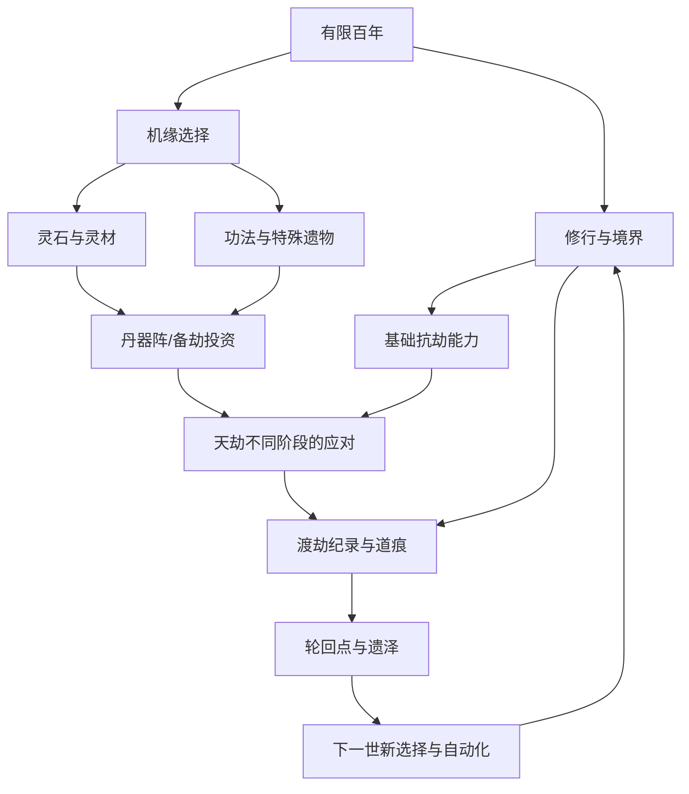

# 04 · 系统耦合与资源循环

> 最重要的不是“有多少修仙系统”，而是 **一个选择影响至少另一个系统，且不产生一屏幕繁杂菜单**。本文件专注机制的因果关系，不负责具体价格或比例。

## 1. 模块层级（四主入口不变）
| 主入口 | 基础功能 | 中后期嵌入解锁 |
|---|---|---|
| 修行 | 自动修为、境界、闭关、功法 | 炼丹辅助、法则参悟（后续版本） |
| 机缘 | 事件、秘境、遗物、命格互动 | 法宝/器灵、稀有传承 |
| 备劫 | 天劫预告、护界投入、战前配置 | 阵法、宗门助力（非完整宗门经营） |
| 轮回 | 结算、道痕、永久传承、遗泽 | 道统与世界跨越（后续版本） |

## 2. 资源尽量少（首版建议）
- **修为**：随时间产生，突破并转化为战力/境界门槛的主进度；支持大数。
- **灵石**：机缘、经营式派遣、事件与部分修为转化得到；用于功法研究、丹器、备劫。
- **灵材**：药草、矿料与阵材的**统一抽象资源**（首版不拆成十几种），用于不同流派的配方与建设。
- **本世机缘物**：少量功能性遗物/命格，不作为无限堆积货币。
- **轮回点/道痕**：参见 [03](03-REINCARNATION.md)，跨世持久化。
避免功德、声望、仙缘、神识点、宗门票、碎片币同时存在。

## 3. 系统因果图

## 4. 横向构筑要有差异，而非堆总战力
- **纯修行/剑道**：高爆发，容易快速通过前阶段，对持续侵蚀偏弱。
- **丹修**：消耗灵材和年份，换取保命恢复/稳定突破；打持久战更强。
- **器修**：炼化遗物成法宝特效，单体战力与克制特殊规则；成本更高。
- **阵修（较后开放）**：提前投入灵材与灵石改善护界，抵御群体灾厄；单世临时强项。
四个流派不是初版四套独立复杂小游戏，而是**同一资源/时间底盘上的少量关键配方和被动效果**。初版先验证基础修行+一个生产支援+一件遗物的组合。

## 5. 示例玩法耦合
**事件：荒废剑冢**
- 选择“采矿”→ 灵材增加，可用于阵法/法宝。
- 选择“参悟残剑”→ 花费 3 年获得剑意线索，可能提高当世对“归墟投影”的输出。
- 得到特别遗泽的可能性受已知线索和构筑倾向影响，但保留随机；**没有被指定抽中才能完成主线的硬要求**。
玩家是做“现在缺什么”的决策，不是去解锁三个额外页面。

**事件：青药谷求援**
- 捐出灵材→ 获得稳定丹方研究权限与人情回报。
- 直接出售换灵石→ 当世备劫资源增多，但失去丹修后续连携。
- 机缘与备劫因此发生实质关系。

## 6. 随机事件结构建议
事件定义“出现条件/年份窗口/势力标签/两个或三个有代价的选项/随机结果表/可能留下的世录”。随机性仅选择局面与奖励区间；不能对主线必需物品做极低概率无保底抽取。
- 每世至少提供一种稳定可用路线，无论命格优劣。
- 高稀有事件可以惊喜，但绝不强制玩家看广告提升概率。
- 玩家可通过前世记忆预知部分线索，产生“学习后更强”的感觉。
- 保证同一世不会重复刷无限同名稀有事件。

## 7. 自动化与管理负担
永久传承应自动执行早期重复的低阶修行步骤；随机决策只有在结果真正分歧时中断。后期“宗门”可作为自动化产线和防御支援的单独卡片，而不是每位弟子有独立寻路、背包和好感度。

## 8. 验收问题
- 选择炼丹/法宝，是否会真实改变某阶段天劫的战斗结果？
- 多花 10 年修行与花 10 年备劫是否都有合理局面适合？
- 机缘风险是否有可识别信息，还是完全随机按钮？
- 永久升级是否改变玩家实际决策，不只是数字上涨？
- 任何系统若没有影响其他模块的输出，优先简化或删除。
