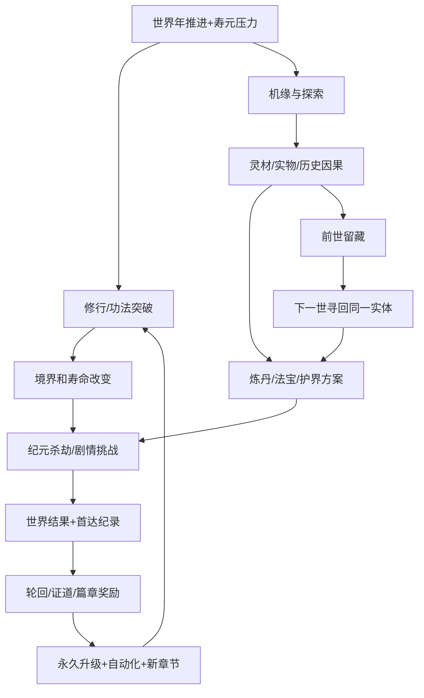

# 14 · 全系统骨架与耦合契约（V0.4）

> 这是**策划层模块图**，不是游戏代码或未来必须实现的全部 MVP 功能。目标是系统之间形成资源/信息/时间闭环，并保持只有「修行 / 机缘 / 应劫 / 轮回」四个主入口。高阶难度章节的权威文档是 [12](12-ERA-STAGES.md)，多阶局外点数的权威文档是 [13](13-PRESTIGE-LAYERS.md)。

## 一、八个逻辑域 + 一个表现层
| 逻辑域 | 输入 | 核心规则 | 输出/影响 | MVP / 长期 |
| --- | --- | --- | --- | --- |
| 1 **世界时钟** | 玩家行动、自动推进、暂停 | 年龄/寿限/世界历、事件触发优先级、保护期 | 寿尽判定、纪元事件窗口 | **MVP核心** / 跨篇章 |
| 2 **修行境界** | 修为、功法、资源、寿元 | 修为生产、突破、境界能力、寿限增长 | 高阶动作、活更久、不同灾劫解法 | **MVP核心** / 化神法则 |
| 3 **机缘探索** | 世界阶段、命格、行动年数、随机种子 | 事件卡、风险/收益选择、秘境、稀有遗物 | 灵石、灵材、技能/线索、历史因果 | **MVP核心** / 主题事件池 |
| 4 **经济与制作** | 灵石、灵材、时间与配方 | 修炼投入、简化炼丹、法宝/阵法制作 | 延寿/抗性/自动化、资源缺口 | **MVP简版** / 专精 |
| 5 **应劫挑战** | 世界危机、境界、物品、势力关系 | 多路径生存门槛、战斗/剧情阶段和失败原因 | 世界后果、RP记录、篇章资格 | **MVP 1关** / 多纪元 |
| 6 **跨世继承** | 死亡/主动轮回、魂印、实物遗藏 | 结算、RP、遗物位置与线索、下一世出身 | 永久成长/前世寻宝 | **MVP核心** / 高阶道统 |
| 7 **证道与跨篇章** | 化神/飞升、应劫纪录、挑战结果 | DP/EP、篇章解锁、世界线存档隔离 | 高阶法则/世界规则 | **仅规划接口** / 中后期 |
| 8 **引导与纪录** | 事件、里程碑、缺口诊断 | 单主目标/次级目标、世录、首次达成去重 | 下一步推荐、解锁提示、玩家成就 | **MVP核心** / 图鉴 |
| 9 **UI/平台适配** | 上述状态快照 | 四入口、分层面板、存档/广告/生命周期适配 | 可读的手机端体验 | **MVP核心** / 真机适配 |

以上域是逻辑上的职责归属，**不是建议让玩家看到九个菜单**。不让画面层持有权威 RP 或稀有物件所有权。

## 二、最短闭环（没有任何一个模块可以无关地挂在外面）

## 三、四种资源、三类长期货币
**本世**：修为（可大数）、灵石、灵材、行动年数；**实体物品**不是通用币。  
**跨世**：轮回点 RP、道果 DP、界源 EP；道痕/世录是不可消费的历史纪录。  
**非货币**：命格、功法流派、魂印、遗物唯一实体、挑战修饰符、势力关系。

每个消费都必须造成机会成本：
- 灵材用于延寿丹则没有足够材料做护劫符。
- 时间花在寻找前世器魂则可能错过一次世界关口的准备。
- 高爆发功法过关速度快，但长期寿元或侵蚀抵抗可能较弱。
- 高阶 DP/EP 优先买自动化可快刷低层，但买法则槽可提高下一次新挑战的胜算。

**不要额外加十几个丹药币、宗门币、秘境票、道心票。** 真正需要拆资源时必须解释为何统一资源无法表达玩家取舍。

## 四、系统逐步解锁（四入口不变）
| 当前阶段 | 修行 | 机缘 | 应劫 | 轮回 |
|---|---|---|---|---|
| 凡人/炼气 | 自动修炼、基础突破 | 两选一机缘 | 首次杀劫倒计时 | 首次死亡后解锁 RP |
| 筑基/初次轮回 | 功法倾向、延寿丹 | 遗物留存与寻回 | 生存路线选择 | RP 传承、魂印 |
| 金丹/元婴 | 进阶突破、基础炼器 | 秘境与器魂 | 多段危机/阵法 | 命格与构筑模板 |
| 化神 | 法则方向 | 特殊证道机缘 | 证道试炼 | **新增 DP 页签** |
| 飞升/跨篇章 | 高阶修炼规则 | 天路/历史秘境 | 不同篇章危机 | **新增 EP 页签与纪元选择** |

这里是功能“认知曲线”，解锁**以成长里程碑为主，轮回次数作为替代方式或提示**，不允许“为了开基本炼丹必须空刷第7世”。

## 五、挑战的模板系统
每个重大挑战定义：
- `challengeId`、`stageId`、世界历/剧情触发条件、预警窗口；
- 危机类型：爆发/持续侵蚀/身份清算/法则禁用等；
- 至少两条可达生路（例境界 + 抗性，或完成势力托付）；
- 首次/重复奖励分开，特殊规则修饰符声明收益和限制；
- 结果：成功/局部幸存/死亡、世界状态摘要变化、世录、可解锁篇章。

高层挑战可以通过**复用已有危机机制+新的修饰符组合**产生多次新策略，但每一档必须有清晰目标；禁止纯乘敌人HP作为所有玩法。

## 六、机缘系统三层池
1. **稳定事件池**：普通灵材、延寿线索、可选势力庇护。无 RNG 软锁，确保存在基础生存路线。
2. **构筑事件池**：奇遇功法、遗物、器魂、命格联动，差异化本世决策。
3. **稀有惊喜池**：隐藏剧情、异变、天命转折，极低概率可带来难忘经历，但不构成唯一通关条件。

玩家知道大致风险、消耗的年份和可见选项；世界阶段、上世因果、当世功法和历史里程碑影响候选池。种子必须可重放，重开相同事件不用于刷独占奖励。

## 七、自动化是高层成长的实物反馈
- RP：自动突破已经多次达到的低境界、一次性批量炼基础丹、简化基础机缘领取。
- DP：保存可复用的功法模板，自动处理不构成选择的低层任务；新法则取舍仍手动。
- EP：高层章节允许旧篇章快捷模拟和自动批量结算普通产出，**但不自动越过玩家尚未见过的致命事件或重要选择**。
- 对每个自动化技能给出“取代哪个重复操作、保留哪个决策”的设计说明；自动化必须可关闭。

## 八、实体遗物与世界线的依赖
前世物件按 [11](11-LEGACY-ITEMS.md) 的唯一 ID 从世界位置**转移所有权**；切换纪元篇章不能拷贝装备库存。魂印是精神刻印而非物件本体。旧篇章的世界线暂停并保留历史摘要，回去后可继续寻找旧物；同一物件不能同时出现在两个世界线。

## 九、技术可验证的状态域（非代码目录）
`AccountProgress(RP,DP,EP,achievements,unlocks,soulImprints)`  
`StageSlots(stageId,worldlineId,worldYear,epochFlags,historySummary,stashLedger)`  
`CurrentLife(lifeId,age,lifeCap,realm,resources,traits,items)`  
`ChallengeState(id,warning,choices,outcome,firstClearClaimed)`  
`RunJournal(earnedRewards,spends,choices,randomSeed,saveVersion)`

跨域写入用单次事务和幂等 ID：轮回点发币 / 物品移交 / 首达奖励 / 篇章切换必须保证异常恢复不复制收益。

## V0.4 现实范围收敛
第一版体验必须满足 [17](17-SESSION-PACING.md) 与 [18](18-PAPER-PLAYTEST.md)：四主入口、三种基础资源、最多一场完整世界史致命事件、10–12个模板、4–6个RP节点、一个前世实物闭环。所有高级DP/EP、宗门精细经营、离线免费修为和跨篇章切换仅是长线结构，不是MVP开发事项。一个历史事件在同一worldlineId内只发生一次，后世由余波/纪元变化接力提供内容。

## 十、反复杂化验收
如果去掉一种系统，玩家决策与下一关生存结果都不改变，那它不应该进入 MVP。每增加一个章节，至少带来**一个新规则、一种新策略、一个明确纪录目标**。每新增一层局外成长，至少引入一种真正的功能变化而不是纯加倍率。
