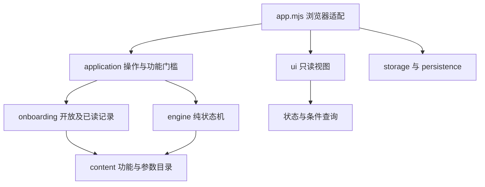

# 网页原型架构

当前维护对象是 `prototype/next/`。这是无运行时依赖的浏览器ES Modules项目；`prototype/` 根下的V1.0是历史对照，不参与新版扩展。

## 目录与职责

```text
prototype/next/
  app.mjs                   浏览器协调：命令、焦点、路由、设备、存档传输
  game.mjs                  纯逻辑兼容出口，供模拟和既有测试使用
  presentation.mjs          旧呈现导入路径的兼容出口
  content/
    catalog.mjs             计划、职业、研究、遗物与存档版本
    features.mjs            19项功能的开放条件、基础介绍、入口及年份阈值
    audio.mjs               五类CC0采样文件和类别音量
  engine/
    state.mjs               初始状态、人物、日志、NPC年龄查询
    shared.mjs              数值取整、资源扣款等无状态工具
    economy.mjs             年产率、工资、职业经验、研究、维护与炼气
    events.mjs              世界/人生到期事件及优先顺序
    chronicle.mjs           离世结算、人物缺席时的转世间隔世界史
    runtime.mjs             年推进、行动、事件选择和当世操作
    persistence.mjs         存档结构校验、v2→v3迁移与序列化
  application/
    commands.mjs            玩家操作入口、功能门槛、逐年发现停点
    onboarding.mjs          永久开放、已读状态、提示收起/重播
    selectors.mjs           当前目标与下一节点预测
    storage.mjs             默认/独立存档槽、失败备份、保存错误反馈
    preferences.mjs         本机QoL默认值、校验、存取与确认文案
    save-transfer.mjs       导入校验、替换前备份、原子写入顺序
    feedback.mjs            可持久化命令目录与真实资源差额提示
    notifications.mjs       可用操作与新介绍的只读红点查询
  browser/
    audio.mjs               手势启动的Web Audio、后台暂停和独立音量
    sound-bank.mjs          WAV加载、解码、并发、节流与停止回收
    music.mjs               双媒体流BGM、曲尾淡化、暂停与重播
    view-state.mjs          页面hash、锁定校验与会话滚动记忆
    dom.mjs                 红点、焦点定位与弹层键盘约束
  ui/
    components.mjs          转义、数字、图标、基础控件
    sanctuary.mjs           墨青金环首页、主景、导航
    pages.mjs               经营、机缘、应劫、轮回页面
    modals.mjs              剧情、开局、离世、内容边界弹层
    guide.mjs               功能介绍卡、锁定说明、指引手册
    shortcuts.mjs           首页日程捷径与达标机会定位
    settings.mjs            设置页面与快进/轮回确认弹层
    render.mjs              组合页面，不执行游戏状态变更
  styles/
    theme.css               墨青金环主题及响应式
    onboarding.css          功能指引、锁定状态及手册
    mobile.css              48px触控、轻量美术、设置与阅读偏好
    qol.css                 常用操作、响应式双栏、滑杆与结果提示
  style.css                 兼容样式入口；HTML并行加载四张CSS
  assets/                   独立场景和人物美术；无烘焙数值与按钮
  tests/                    逻辑、指引、迁移、时间边界和八组合路线
```

## 调用方向



- `engine/` 和 `content/` 不导入DOM、localStorage或UI模块，Node可以直接运行。
- 玩家操作统一经 `dispatch()`。界面门槛和执行门槛读取同一份功能状态；隐藏/禁用按钮不是唯一防线。
- `game.mjs` 保留旧模拟接口。直接调用这些引擎原语用于数值/状态机测试，**不代表玩家已解锁对应功能**。
- `ui/` 只读状态并输出HTML，不发资源、不推进年份、不标记介绍已读。已读及开放写入由应用层处理。
- 引擎的时间推进、行动结算与选择仍在同一运行时协调，避免拆文件时产生相互导入的时钟或多次年结算。

## 三层状态

| 层 | 字段 | 轮回行为 |
|---|---|---|
| 当世 | `life`：年龄、修为、现金、职业、研究、当前/挂起行动 | 新建人物；旧实体留在世界 |
| 世界 | `worldYear`、`world`：事件、NPC、地区、唯一实物 | 持续向前 |
| 账号 | `meta`：RP、职业/研究纪录、灵藏、世录、`guide` | 保留 |

`meta.guide`为 `{version:1, unlocked:[], seen:[], muted:false}`。它只记录认知与开放，不是新货币，不替代世界历史旗标。第一次发现的功能跨世保留；介绍未读不会阻止玩家正常求生。

## 年推进和事件

一次普通推进：年龄与世界年各加1 → 结算一次日程或行动维护 → 减行动剩余年 → 寿尽检查 → 到期事件检查 → 无事件时完成行动。

世界60/95事件先于个人阶段事件。到期条件采用“已到且未处理”，不会因另一个事件占用同一年而永久丢失；处理选择后会再次检查同年到期项。重大事件总是比新手提示优先。

普通跨年行动遇到剧情合作/地方事件时，原行动进入 `life.suspendedActions`。剧情子行动结束后恢复原剩余年份；这段状态也能存取，不重复扣原行动费用。普通操作不能任意覆盖行动。

转世间隔没有当世人物，世界60灵潮记作 `unwitnessed`；95年无干预则地区受损。历史仍只发生一次，不向新身体补发死亡检查或首达奖励。间隔达到160则安全暂停。

## 行动校验与费用

`engine/runtime.mjs` 的 `actionStatus(g,id,variant)`是行动条件查询入口，返回 `{ok,reason,spec?}`，不会扣款或推进。`begin()`复用同一查询，UI也读取它解释资源、资格、行动占用和灵潮截止原因。

修改行动费用/年份：先改运行时的行动规格，再检查相关界面文案与 `content/features.mjs` 介绍，更新两类测试。不要在视图里添加一套新的执行判定。

## 存档兼容

- 存档版本为3，默认键仍是 `bsjl-v12-current`，保留既有玩家数据入口。
- v2经结构校验后迁移，补挂起行动栈；没有指引字段的老玩家保留旧UI已有功能，相关介绍标记已读。后续新发现正常介绍。
- 损坏存档先备份到同键的 `-recovery-<时间戳>` 后缀。备份失败时开启写保护，停止覆盖原始内容并提示导出。
- 界面会显示真实保存失败；导出JSON由用户点击触发。导出文件可用于开发者协助恢复，设置页可导入并预览，在替换前备份原始存档；备份或写入失败不替换运行状态。
- 测试可用 `?slot=<字母数字短横线>` 创建独立槽，不能把开发验收进度覆盖到默认玩家槽。

## 扩展入口

添加功能按 [ONBOARDING](ONBOARDING.md) 执行；更改流程前跑 [RUNBOOK](RUNBOOK.md) 中的检查。当前限制集中在 [BACKLOG](BACKLOG.md)，不要从历史策划里推断尚未实现的系统已存在。

## 本机体验状态

设置保存在独立键 `bsjl-device-preferences-v1`，不放进人物/世界/账号存档，也不随轮回或重开重置。`preferences.mjs`负责字段白名单、默认值和音量范围；`notifications.mjs`复用 `actionStatus()`与开放记录。DOM红点与设备属性由 `app.mjs`绘制。声音位于 `browser/audio.mjs`，引擎不依赖音频设备。交互确认在浏览器适配层，确认之前不派发游戏命令。扩展规则见[EXPERIENCE](EXPERIENCE.md)。

## 绘制、存储与加载

切页、介绍、设置和音量试听不再保存整份游戏。变更命令成功后由`createSaveWriter()`比较序列化快照，确有变化才同步写入；保存失败保留失败提示并允许后续重试。浏览状态保存在按槽区分的sessionStorage，不进入游戏存档。另一窗口更新同槽时，本窗口停止写入并提示刷新。

折叠管理区关闭时不构建隐藏控件，展开再生成；关闭插画时不输出人物img。数字格式器复用实例，音量拖动只更新滑杆/输出和音频总线，松手后保存偏好，不整页重绘。HTML并行加载样式，保留原ES Modules开发方式，无新增运行时依赖。MP3在用户启用后通过媒体流播放，不整体解码为常驻AudioBuffer。详细实测见[QOL-VALIDATION](QOL-VALIDATION.md)。
